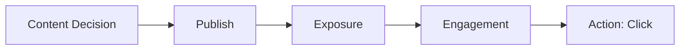

# Process Context

## Business process map

Đây là flow logic được xây dựng từ brief và các trường dữ liệu, chưa phải SOP được doanh nghiệp xác nhận. Người dùng có thể click mà không like/comment. Dataset không theo dõi hành trình từng người; các mũi tên không chứng minh chuyển đổi tuần tự hoặc nhân quả.

## Input / activity / output

| Tầng | Input | Activity | Output quan sát được |
| --- | --- | --- | --- |
| Content Decision | Mục đích nội dung và lựa chọn phân phối | Chọn kênh, chủ đề, định dạng, hashtag, thị trường, lịch | Platform, Content_Category, Post_Type, Main_Hashtag, Region, Content_Type |
| Publish | Nội dung và lịch đã chọn | Xuất bản | Post_ID, Post_Published_At, Post_Date, Post_Hour |
| Exposure | Bài đã xuất bản | Nội dung được hiển thị/xem | Impressions, Views, Video_Views, Live_Stream_Views |
| Engagement | Nội dung đến người xem | Người xem phản hồi | Likes, Shares, Comments, Engagement, Engagement_Rate |
| Action | Nội dung và khả năng click | Người xem nhấp | Clicks, Click_Through_Rate trên record có dữ liệu |

## Controllable factors

Team marketing có thể lập kế hoạch lựa chọn **Platform, Content_Category, Post_Type, Main_Hashtag, thời điểm đăng, Content_Type (Organic/Sponsored) và thị trường hướng tới**. Region cho phép phân nhóm địa lý; dataset chưa xác nhận thiết lập targeting thực tế.

Views, impressions, tương tác và click là kết quả quan sát, không phải yếu tố team trực tiếp ấn định. Brief chưa mô tả quy trình duyệt bài, ngân sách, bidding hoặc thuật toán phân phối.

**Nguồn:** [Business brief](../../Social%20Media%20Marketing%20Performance%20Analytics.pdf); [Excel](../../data/Social_Media_Content_Performance_Dataset.xlsx).
