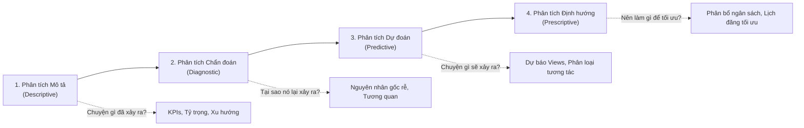

# KHUNG PHÂN TÍCH KINH DOANH 4 CẤP ĐỘ (4-LEVEL BUSINESS ANALYTICS FRAMEWORK)
**Dự án:** Social Media Content Performance Analytics  
**Tập dữ liệu nền tảng:** `Social_Media_Content_Performance_Dataset.xlsx` (5,600 quan sát, 24 trường)  
**Mục tiêu:** Định hình câu hỏi kinh doanh, phương pháp kỹ thuật, công cụ triển khai trên dữ liệu hiện tại và lộ trình mở rộng dữ liệu phục vụ tăng trưởng doanh thu & tối ưu ROI.

---

## TỔNG QUAN KHUNG PHÂN TÍCH 4 CẤP ĐỘ

---

## 1. PHÂN TÍCH MÔ TẢ (DESCRIPTIVE ANALYTICS) — "CHUYỆN GÌ ĐÃ XẢY RA?"

### 1.1. Câu hỏi kinh doanh sâu sắc (Business Questions)
1. **Hiệu suất tổng thể theo kênh:** Tỷ trọng phân bổ lượt xem (`Views`), tương tác (`Engagement`) và mức độ tiếp cận (`Impressions`) giữa 6 nền tảng đang diễn ra như thế nào? Nền tảng nào đóng vai trò là "kênh lan tỏa" (Reach Engine) và nền tảng nào là "kênh chuyển đổi/tương tác sâu" (Community & Conversion Engine)?
2. **Hiệu quả định dạng & danh mục nội dung:** Định dạng bài viết nào (`Video`, `Live Stream`, `Image`, `Article`, `Carousel`) và danh mục nội dung nào (`Educational`, `Product Promotion`, `Customer Story`, v.v.) đang chiếm ưu thế về Tỷ lệ tương tác (`Engagement_Rate`) và Tỷ lệ nhấp (`Click_Through_Rate`)?
3. **Mô hình hóa thời gian & địa lý (Temporal & Geographic Heatmap):** Phân bố lượng truy cập theo khung giờ đăng bài (`Post_Hour` từ 8h–19h) và khu vực thị trường (`Region`) có đặc điểm tập trung nào đáng chú ý?

### 1.2. Công cụ & Kỹ thuật phân tích
- **Công cụ (Tools):** Tableau / Power BI (Dashboard tương tác), Python (`pandas`, `seaborn`, `plotly`), SQL (Aggregate queries).
- **Kỹ thuật (Techniques):**
  - **Cohort & Segmentation Analysis:** Phân đoạn hiệu suất theo nền tảng x định dạng nội dung x khu vực.
  - **Pareto Analysis (Quy tắc 80/20):** Xác định 20% bài đăng hàng đầu mang lại 80% tổng lượng tương tác và hiển thị.
  - **Heatmap Matrix:** Bản đồ nhiệt giao thoa giữa `Post_Hour` và `Platform` đối với `Engagement_Rate`.
  - **Geographical Geo-mapping:** Trực quan hóa bản đồ theo tọa độ `Latitude`, `Longitude` để so sánh mật độ tương tác giữa 8 thị trường.

### 1.3. Ứng dụng trên dữ liệu hiện tại
- Đo lường chi tiết 5,600 bài đăng qua các chỉ số trung bình (Mean), trung vị (Median), độ lệch chuẩn của `Engagement_Rate` (5.0% – 26.9%) và `CTR` (1.0% – 3.0%).
- So sánh tỷ trọng nội dung tự nhiên `Organic` (83%) vs nội dung quảng cáo `Sponsored` (17%).

### 1.4. Hướng phát triển & Thu thập dữ liệu lớn hơn (Data Expansion)
- **Dữ liệu cần bổ sung:** 
  - Chi phí quảng cáo thực tế (Ad Spend, Cost Per Mille - CPM, Cost Per Click - CPC).
  - Tỷ lệ giữ chân người xem video theo từng giây (Audience Retention Curve: 3s, 10s, 50%, 100%).
  - Dữ liệu nhân khẩu học chi tiết của khán giả (Độ tuổi, Giới tính, Ngành nghề, Thiết bị truy cập).
- **Ý nghĩa kinh doanh đột phá:** Cho phép tính toán chính xác chi phí để có 1 lượt tương tác (Cost Per Engagement - CPE) và chi phí tiếp cận 1.000 khách hàng mục tiêu theo từng thị trường cụ thể.

---

## 2. PHÂN TÍCH CHẨN ĐOÁN (DIAGNOSTIC ANALYTICS) — "TẠI SAO NÓ LẠI XẢY RA?"

### 1.1. Câu hỏi kinh doanh sâu sắc (Business Questions)
1. **Giải mã nguyên nhân bài đăng bùng nổ (Viral Content Drivers):** Yếu tố nào đóng góp mạnh nhất vào việc một bài đăng đạt mức `Engagement_Level = 'High'`? Là do sự kết hợp của định dạng `Video` + khung giờ vàng, hay do sức mạnh của chủ đề (`Customer Story`, `Educational`) và thẻ gắn (`#SuccessStory`, `#CustomerStory`)?
2. **Tại sao tỷ lệ chuyển đổi (CTR) suy giảm trên một số kênh?** Có phải việc tăng tần suất bài đăng `Product Promotion` đang làm "bão hòa" người xem, dẫn đến sụt giảm tương tác tự nhiên so với các nội dung thuần giáo dục (`Educational`)?
3. **Phân tích hiệu quả chi tiêu Organic vs Sponsored:** Tại sao nội dung `Sponsored` có số lượt hiển thị cao hơn nhưng `Engagement_Rate` lại không vượt trội tương ứng so với nội dung `Organic`?

### 2.2. Công cụ & Kỹ thuật phân tích
- **Công cụ (Tools):** Python (`scipy.stats`, `statsmodels`), R Studio, Tableau (Root-cause tree / Scatter drill-down).
- **Kỹ thuật (Techniques):**
  - **Multivariate Correlation Analysis & VIF:** Ma trận tương quan Spearman / Pearson giữa `Views`, `Impressions`, `Likes`, `Shares`, `Comments` và `Engagement_Rate`.
  - **Hypothesis Testing (A/B Testing & ANOVA):** 
    - *Kiểm định One-way ANOVA & Kruskal-Wallis:* Đánh giá sự khác biệt có ý nghĩa thống kê về `Engagement_Rate` giữa 5 danh mục nội dung và 6 nền tảng ($p\text{-value} < 0.05$).
    - *Kiểm định Mann-Whitney U:* So sánh hiệu suất thực tế giữa bài đăng `Organic` vs `Sponsored`.
  - **Feature Importance / SHAP Explainer (Diagnostic Trees):** Sử dụng Decision Tree hoặc Random Forest để bóc tách trọng số ảnh hưởng của các biến đầu vào lên mức độ tương tác.

### 2.3. Ứng dụng trên dữ liệu hiện tại
- Phân tích tương quan giữa `Impressions` và `Clicks` trên 1,860 bài đăng có ghi nhận chuyển đổi.
- Bóc tách nguyên nhân tại sao Hashtag `#SuccessStory` và `#CustomerStory` chiếm hơn 45% tổng bài viết và có xu hướng giữ tương tác ổn định hơn so với bài đăng quảng cáo thông thường.

### 2.4. Hướng phát triển & Thu thập dữ liệu lớn hơn (Data Expansion)
- **Dữ liệu cần bổ sung:**
  - **NLP Sentiment & Topic Modeling:** Phân tích cảm xúc văn bản (Positive / Neutral / Negative) và chủ đề trong phần bình luận (`Comments`) của người dùng.
  - **Hành vi luồng nhấp (Clickstream & Bounce Rate):** Người dùng nhấp vào link rồi ở lại trang đích bao lâu? Có mua hàng không?
  - **Dữ liệu đối thủ cạnh tranh (Competitive Benchmarking):** Tần suất đăng bài và tương tác của đối thủ cùng ngành trong cùng khoảng thời gian.
- **Ý nghĩa kinh doanh đột phá:** Xác định được chính xác lý do khách hàng rời bỏ hoặc không bấm link (do trang đích chậm, do thông điệp bài viết không khớp sản phẩm, hay do nội dung quá thiên về bán hàng).

---

## 3. PHÂN TÍCH DỰ ĐOÁN (PREDICTIVE ANALYTICS) — "CHUYỆN GÌ SẼ XẢY RA?"

### 3.1. Câu hỏi kinh doanh sâu sắc (Business Questions)
1. **Dự báo mức độ tương tác trước khi xuất bản (Pre-publish Scoring):** Với một kế hoạch bài đăng sắp tới (Ví dụ: Định dạng `Video`, Nền tảng `TikTok`, Danh mục `Educational`, Đăng lúc `15:00` tại `USA`), bài đăng này có xác suất bao nhiêu % đạt mức `Engagement_Level = 'High'`?
2. **Dự báo tổng lượng Reach & Views dự kiến:** Bài đăng dự kiến sẽ đạt được bao nhiêu `Views`, `Impressions` và `Clicks` trong vòng 30 ngày tới để team Marketing chuẩn bị năng lực hỗ trợ khách hàng/server?
3. **Dự báo xu hướng chu kỳ (Trend & Seasonality Forecasting):** Lượng tương tác tổng thể trên từng nền tảng sẽ biến động như thế nào trong 3–6 tháng tới theo yếu tố mùa vụ hoặc ngày trong tuần?

### 3.2. Công cụ & Kỹ thuật phân tích
- **Công cụ (Tools):** Python (`scikit-learn`, `xgboost`, `lightgbm`, `prophet`, `optuna`), SQL / BigQuery ML, MLflow (quản lý model).
- **Kỹ thuật (Techniques):**
  - **Multi-class Classification:** Huấn luyện các thuật toán như XGBoost Classifier, Random Forest, LightGBM để phân loại bài đăng thành 3 lớp: `Low`, `Medium`, `High`.
  - **Regression Modeling:** Mô hình hồi quy (Gradient Boosting Regressor, Ridge/Lasso) để dự báo giá trị liên tục của `Engagement_Rate` và `Views`.
  - **Time Series Forecasting:** Sử dụng Facebook Prophet hoặc ARIMA/SARIMAX trên dữ liệu chuỗi thời gian (`Post_Date`) để dự báo tổng lượng tương tác hàng tuần/hàng tháng.
  - **Cross-Validation & Evaluation Metrics:** Đánh giá bằng `F1-score (Macro)`, `AUC-ROC`, `RMSE`, `MAE`.

### 3.3. Ứng dụng trên dữ liệu hiện tại
- Xây dựng Pipeline tiền xử lý (One-Hot Encoding cho `Platform`, `Post_Type`, `Region`, `Content_Category`, `Main_Hashtag`; Scaling cho `Post_Hour`).
- Đào tạo mô hình phân loại dự đoán `Engagement_Level` đạt độ chính xác cao dựa trên các đặc trưng tiền xuất bản.

### 3.4. Hướng phát triển & Thu thập dữ liệu lớn hơn (Data Expansion)
- **Dữ liệu cần bổ sung:**
  - **Multimodal Content Embeddings:** Vector hóa hình ảnh, thumbnail, kịch bản video (Computer Vision) và toàn bộ văn bản caption (LLM / BERT Embeddings).
  - **Dữ liệu lịch sử người theo dõi (Follower Growth & Base Size):** Quy mô tài khoản tại thời điểm đăng bài (Số lượng follower lúc đó là bao nhiêu?).
  - **Dữ liệu thời gian thực (Real-time Early Velocity Data):** Lượng views/likes trong 15 phút, 1 giờ đầu tiên sau khi đăng bài để dự đoán bài viết có trở thành "Viral" hay không.
- **Ý nghĩa kinh doanh đột phá:** Cung cấp hệ thống tự động chấm điểm bài viết trước khi xuất bản ("AI Content Quality Gate"), loại bỏ các bài viết có nguy cơ tương tác thấp trước khi tiêu tốn ngân sách chạy quảng cáo.

---

## 4. PHÂN TÍCH ĐỊNH HƯỚNG / ĐỀ XUẤT (PRESCRIPTIVE ANALYTICS) — "NÊN LÀM GÌ ĐỂ TỐI ƯU HÓA?"

### 4.1. Câu hỏi kinh doanh sâu sắc (Business Questions)
1. **Tối ưu hóa phân bổ ngân sách tiếp thị (Marketing Budget Allocation):** Cần phân bổ ngân sách quảng cáo (`Sponsored`) như thế nào giữa các nền tảng (`TikTok`, `YouTube`, `Instagram`, `Facebook`, `LinkedIn`) và các danh mục nội dung để tối đa hóa tổng lượt tương tác và số lượng Click về website?
2. **Khuyến nghị lịch trình xuất bản tối ưu cá nhân hóa (Smart Content Scheduling & Mix):** Vào mỗi ngày trong tuần, tại mỗi thị trường quốc gia cụ thể, lịch xuất bản tối ưu nhất là gì (Nền tảng nào, Giờ nào, Định dạng gì, Hashtag nào) để xác suất đạt `High Engagement` $> 80\%$?
3. **Chiến lược tái phân phối nội dung (Cross-platform Repurposing Strategy):** Một nội dung dạng `Educational Video` hoạt động hiệu quả trên `YouTube` nên được cắt lát, biến đổi sang định dạng nào (`Text`/`Carousel` trên `LinkedIn` hay `Short Video` trên `TikTok`) và đăng tải vào thời điểm nào để tận dụng tối đa vòng đời nội dung?

### 4.2. Công cụ & Kỹ thuật phân tích
- **Công cụ (Tools):** Python (`scipy.optimize`, `PuLP`), Reinforcement Learning (Multi-Armed Bandits), Hệ thống khuyến nghị (Recommender Engines).
- **Kỹ thuật (Techniques):**
  - **Linear / Integer Programming (Quy hoạch tuyến tính):** Tối ưu hóa hàm mục tiêu (Tổng Clicks hoặc Tổng Engagement) dưới các ràng buộc về số lượng bài đăng tối đa mỗi ngày, tỷ trọng thể loại nội dung và ngân sách.
  - **Multi-Armed Bandit (MAB / Contextual Bandits):** Tự động điều chỉnh tỷ trọng phân phối giữa các định dạng nội dung (Thử nghiệm định dạng mới vs Khai thác định dạng hiệu quả cao).
  - **Prescriptive Decision Matrix & Recommendation Rule Engine:** Xây dựng bảng quy tắc ra quyết định tự động đề xuất hành động cho Content Creator.

### 4.3. Ứng dụng trên dữ liệu hiện tại
- Xây dựng ma trận khuyến nghị: Đưa ra bộ kết hợp tối ưu nhất dựa trên dữ liệu lịch sử (Ví dụ: Đối với thị trường `USA`, khung giờ đăng đạt hiệu quả cao nhất trên `TikTok` là `15h-17h` với dạng `Video` và hashtag `#SuccessStory`).

### 4.4. Hướng phát triển & Thu thập dữ liệu lớn hơn (Data Expansion)
- **Dữ liệu cần bổ sung:**
  - **Doanh thu thực tế & LTV (Customer Lifetime Value):** Doanh thu tạo ra từ mỗi chiến dịch (kết nối trực tiếp với CRM như HubSpot/Salesforce).
  - **Chi phí sản xuất nội dung (Content Production Cost):** Chi phí thuê Creator, chi phí quay dựng video, thời gian nhân sự sản xuất từng định dạng (`Video` vs `Article` vs `Image`).
  - **Mô hình quy kết đa kênh (Multi-touch Attribution Data):** Điểm chạm mạng xã hội đóng góp bao nhiêu % vào quyết định mua hàng cuối cùng của khách hàng.
- **Ý nghĩa kinh doanh đột phá:** Chuyển đổi bộ phận Marketing từ một **"Trung tâm chi phí" (Cost Center)** thành **"Động lực tạo doanh thu" (Revenue Driver)** thông qua việc tính toán chính xác chỉ số **ROAS (Return on Ad Spend)** và **ROMI (Return on Marketing Investment)** cho từng đồng vốn đầu tư.

---

## TỔNG KẾT SO SÁNH 4 LOẠI PHÂN TÍCH

| Loại phân tích | Câu hỏi cốt lõi | Kỹ thuật chính | Đầu ra nghiệp vụ (Actionable Output) | Giá trị kinh doanh mang lại |
| :--- | :--- | :--- | :--- | :--- |
| **1. Descriptive** | *Chuyện gì đã xảy ra?* | Dashboard, KPI Aggregation, Heatmap, Pareto 80/20 | Báo cáo hiệu suất, Dashboard thời gian thực | Minh bạch hóa dữ liệu, nắm bắt hiện trạng |
| **2. Diagnostic** | *Tại sao lại xảy ra?* | Hypothesis Testing (ANOVA, Chi-square), Correlation, SHAP | Báo cáo nguyên nhân gốc rễ (Root-cause Report) | Hiểu rõ động lực thúc đẩy tương tác, giảm lãng phí |
| **3. Predictive** | *Chuyện gì sẽ xảy ra?* | Machine Learning (XGBoost, Random Forest), Time-Series | Điểm đánh giá tiềm năng bài viết (Pre-publish Score) | Chủ động kế hoạch, giảm rủi ro nội dung thất bại |
| **4. Prescriptive** | *Nên hành động ra sao?* | Linear Optimization, Multi-Armed Bandits, Rule Engines | Lịch đăng bài tối ưu, Kế hoạch phân bổ ngân sách | Tối đa hóa ROI, tự động hóa quy trình ra quyết định |
